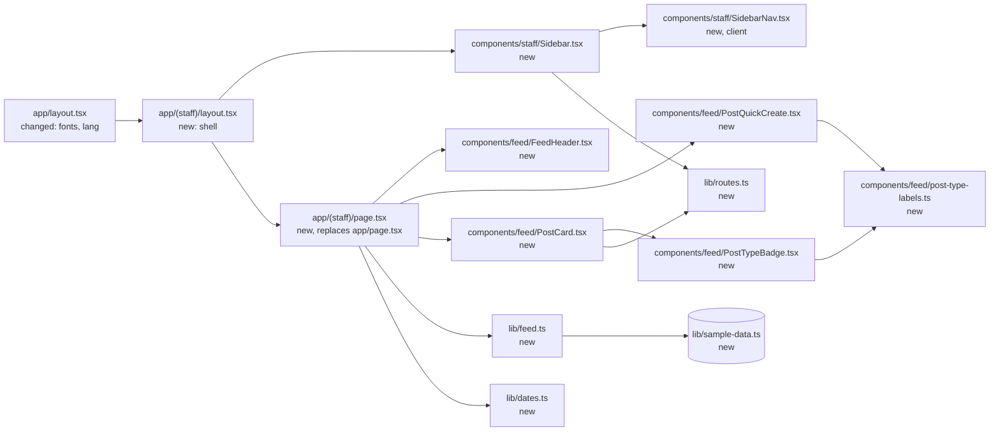
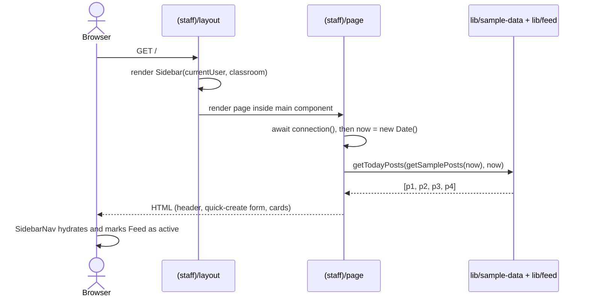

# SPEC 01 — Staff feed as home page · Design

> **Spec:** [requirements](./requirements.md) · design · [tasks](./tasks.md)

## Overview

This first spec turns the `create-next-app` starter into the staff Feed screen. A `(staff)` route group holds a shared layout that renders the sidebar shell, and its `page.tsx` renders the feed at `/`. Everything is a Server Component except the nav list, which needs `usePathname()` to mark the active item. Data comes from a typed sample-data module in `lib/`, standing in for a future persistence spec. The page opts into request-time rendering with `connection()` so "today" is always the real date. Design tokens become Tailwind v4 theme tokens in `app/globals.css`, and fonts are self-hosted with `next/font/google`.

**Language rule.** All code is in English: identifiers, types, file and route names, and comments. Spanish (es-419) UI strings live only in the rendered templates under `app/` and `components/`. `lib/` contains no UI copy. The only Spanish text in `lib/` is sample *content* (people's names and post bodies), which is user data, not UI.

## Architecture



## Components and interfaces

### `app/layout.tsx` (changed)

The root layout.

- Loads `Fredoka` and `Nunito` via `next/font/google` (both are variable fonts, so no weight list is needed; Nunito also loads `style: ["normal", "italic"]`). It exposes them as CSS variables `--font-fredoka` and `--font-nunito`. Geist is removed.
- `<html lang="es-419">`, `metadata = { title: "OpenDayCare", description: "La guardería, día a día." }`.
- `<body>` gets the base background and text tokens and antialiasing.

### `app/globals.css` (changed)

Replaces the starter tokens and the dark-mode block with the prototype palette under `@theme inline`:

| Token | Value | Use |
| --- | --- | --- |
| `--color-cream` | `#F6ECDF` | page background, logout button bg |
| `--color-surface` | `#FFFDF9` | sidebar, cards |
| `--color-ink` | `#3F362E` | headings, names |
| `--color-body` | `#4A4038` | post body text |
| `--color-nav` | `#6E6359` | inactive nav items |
| `--color-muted` | `#94887B` | subtitle, comment count |
| `--color-subtle` | `#A89A8B` | meta text, placeholder |
| `--color-line` | `#ECE0D0` | borders |
| `--color-line-soft` | `#F0E6D8` | card footer border |
| `--color-divider` | `#E7DAC8` | "today" section rule |
| `--color-divider-label` | `#8A7C6D` | "today" section label |
| `--color-accent` | `#F2937A` | user avatar |
| `--color-accent-strong` | `#E0654A` | heart |
| `--color-accent-text` | `#D9583C` | eyebrow, active nav |
| `--color-accent-soft` | `#FBE3D8` | active nav bg |
| `--color-edit` | `#C5503A` | edit link |
| `--color-photo-bg` / `-border` / `-fg` | `#F4ECE1` / `#DBCDBA` / `#B0A290` | photo placeholder |
| `--font-display` | `var(--font-fredoka)` | `font-display` utility |
| `--font-sans` | `var(--font-nunito)` | default body font |

One-off values (gradients, shadows, badge and avatar colors, the 248px sidebar, the 760px column) stay as Tailwind arbitrary values at their single point of use. The prototype's thin custom scrollbar rule is ported as plain CSS.

### `app/page.tsx` (deleted) → `app/(staff)/page.tsx` (new)

The Feed page at `/`. The route group does not add a URL segment, and both files would resolve to `/`, so the old file must be removed.

- `export default async function FeedPage()`: calls `await connection()` (from `next/server`), sets `now = new Date()`, reads `getTodayPosts(getSamplePosts(now), now)`, and renders `FeedHeader`, `<PostQuickCreate user={currentUser} kids={children} />`, the "PUBLICADO HOY" divider, then either the `PostCard` list or the empty-state line "Todavía no hay publicaciones hoy.".
- For each post it resolves `author` (from `staff`) and `child` (from `children` when `audience.kind === "family"`), and computes `isOwn = post.authorId === currentUser.id`.

### `app/(staff)/layout.tsx` (new)

The staff shell, shared by future staff screens.

- `export default function StaffLayout({ children }: LayoutProps<"/">)`: a flex row with `<Sidebar user={currentUser} classroom={classroom} />` and `<main className="h-screen flex-1 min-w-0 overflow-y-auto">`. Inside `main` sits the centered column (`max-w-[760px] px-10 pt-[34px] pb-20`).
- The sidebar is `sticky top-0 h-screen` and only `main` scrolls, which satisfies 1.4.

### `components/staff/Sidebar.tsx` (new)

A Server Component that renders the brand link, the "Nueva publicación" button, `<SidebarNav />` and the user card.

- Props: `{ user: StaffMember; classroom: Classroom }`.
- UI strings: "Sala {classroom.name}", "Nueva publicación", "{user.roleLabel}"… see the role note under **Data model**. The logout `title` is "Cerrar sesión".

### `components/staff/SidebarNav.tsx` (new, `"use client"`)

- No props. It holds a static `NAV_ITEMS: { label: string; href: string; icon }[]` with the Spanish labels "Feed", "Niños", "Avisos" and "Mi cuenta" pointing to `routes.home`, `routes.children`, `routes.notifications` and `routes.account`. An item is active when `usePathname() === href`.

### `components/feed/FeedHeader.tsx` (new)

- Props: `{ classroom: Classroom; user: StaffMember; now: Date }`.
- Renders "GUARDERÍA · SALA {name.toUpperCase()}", "Hola, {user.firstName}" and "{count} {count === 1 ? "niño" : "niños"} · {formatHeaderDate(now)}". The pluralization lives here because it is UI copy.

### `components/feed/PostQuickCreate.tsx` (new)

The quick-create form at the top of the feed. It is a Server Component with no handlers: a plain `<form>` with uncontrolled native fields. The browser keeps the typed values (2.7), and nothing is submitted (2.8).

- Props: `{ user: StaffMember; kids: Child[] }`. The prop is `kids`, not `children`, to avoid clashing with React's `children` prop.
- Structure:
  - Top row: the user's initial avatar (40px, `--color-accent`) next to a `<textarea name="body" rows={3} placeholder="Comparte un momento…" aria-label="Comparte un momento">`.
  - Bottom row: `<select name="audience" aria-label="Para">` with "Toda la sala" (`value="classroom"`, default) then one `<option value={child.id}>{child.name}</option>` per child; `<select name="type" aria-label="Tipo">` with `POST_TYPE_LABELS` (`defaultValue="announcement"`); a spacer; then `<button type="button">Publicar</button>`.
- `type="button"` means clicking "Publicar" never submits, navigates or resets (2.8). Enter in the textarea inserts a newline.
- Styling: the card keeps the prototype composer's container (surface, `--color-line` border, 18px radius, soft shadow). The textarea, selects and button borrow from `crear-publicacion.dc.html`: textarea with a `1.5px #EADFD0` border, white background, 14px radius and placeholder `#B6A99B`; pill selects like the reference's unselected chips (`--color-line` border, `--color-surface` bg, `--color-nav` text, weight 700); "Publicar" uses the sidebar button's coral gradient at a smaller size.

### `components/feed/post-type-labels.ts` (new)

- `POST_TYPE_LABELS: Record<PostType, string>` = `{ achievement: "Logro", activity: "Actividad", announcement: "Anuncio" }`. This is the single source of the Spanish type names, shared by the quick-create selector and the badge. It lives in `components/` because it is UI copy.

### `components/feed/PostCard.tsx` (new)

- Props: `{ post: Post; author: StaffMember; child: Child | null; isOwn: boolean }`.
- The header branches on `post.audience.kind`: `"family"` shows the child avatar, the child's name and "Para: familia de {child.name}"; `"classroom"` shows the megaphone, "Anuncio general" and "Para: toda la sala".
- Meta line: "{formatTime(post.publishedAt)} · publicado por {isOwn ? "ti" : author.firstName}".
- The heart is a plain `<span>` with no handler (4.11). The comment count (`routes.postDetail(id)`), the photo (`routes.postPhoto(id)`, "Foto · {photoCaption}") and "Editar" (`routes.postEdit(id)`, only when `isOwn`) are `<Link>`s.

### `components/feed/PostTypeBadge.tsx` (new)

- Props: `{ type: PostType }`.
- `POST_TYPE_BADGES: Record<PostType, { className: string; dotClassName: string }>`, written as full static Tailwind class strings. The label is `POST_TYPE_LABELS[type]` rendered with the `uppercase` utility, so it reads "LOGRO", "ACTIVIDAD" or "ANUNCIO".

### `components/icons.tsx` (new)

Inline SVG components copied from the prototype markup: `SunIcon`, `PlusIcon`, `HomeIcon`, `UsersIcon`, `BellIcon`, `UserIcon`, `LogOutIcon`, `HeartIcon`, `MessageIcon`, `MegaphoneIcon`, `ImageIcon`. Each takes `{ size?: number; className?: string }` and uses `stroke="currentColor"`.

### `lib/routes.ts` (new)

```ts
export const routes = {
  home: "/",
  postNew: "/posts/new",
  children: "/children",
  notifications: "/notifications",
  account: "/account",
  login: "/login",
  postDetail: (id: string) => `/posts/${id}`,
  postEdit: (id: string) => `/posts/${id}/edit`,
  postPhoto: (id: string) => `/posts/${id}/photo`,
} as const;
```

Naming: entity first, then the action or view (`postNew`, `postDetail`, `postEdit`, `postPhoto`). Single-screen sections keep a plain name (`home`, `children`, `notifications`, `account`, `login`).

### `lib/dates.ts` (new)

- `LOCALE = "es-419"`, `TIME_ZONE = "Europe/Madrid"` (Barcelona; the testing choice, a single constant to change later).
- `formatHeaderDate(d: Date): string` → `"viernes 3 oct"`. It uses `Intl.DateTimeFormat(LOCALE, { weekday: "long", day: "numeric", month: "short", timeZone: TIME_ZONE })`, then `formatToParts`, keeping only the weekday/day/month parts, lowercased, with trailing `.` removed. Spanish month and weekday names come from `Intl`, not from literals.
- `formatTime(d: Date): string` → `"14:20"` (`hour: "2-digit", minute: "2-digit", hourCycle: "h23"`, same timezone).
- `dayKey(d: Date): string` → `"2026-10-03"` in `TIME_ZONE` (via `en-CA` formatting).
- `zoneOffset(ymd: string): string` → the `TIME_ZONE` UTC offset on that day (e.g. `"+02:00"` in summer, `"+01:00"` in winter), read from `Intl.DateTimeFormat("en-US", { timeZone: TIME_ZONE, timeZoneName: "longOffset" })` evaluated at noon UTC of that day. Madrid observes DST, so the offset can't be hardcoded.
- `atLocalTime(now: Date, hhmm: string, dayOffset = 0): Date` → builds `new Date(`${ymd}T${hhmm}:00${zoneOffset(ymd)}`)`, where `ymd` is `dayKey(now)` shifted `dayOffset` days earlier.

### `lib/feed.ts` (new)

- `getTodayPosts(posts: Post[], now: Date): Post[]` keeps posts where `dayKey(post.publishedAt) === dayKey(now)` and sorts them by `publishedAt` descending.

### `lib/sample-data.ts` (new)

Stand-in for persistence. It exports `currentUser`, `staff`, `classroom`, `children`, and `getSamplePosts(now: Date): Post[]`. Timestamps are built with `atLocalTime(now, …)`, so the sample posts are always "today".

| id | type | audience | author | time | photoCaption | reactions | comments |
| --- | --- | --- | --- | --- | --- | --- | --- |
| `p1` | achievement | family of Mateo | Caro (current user) | 14:20 | — | 3 | 1 |
| `p2` | activity | family of Mateo | Caro (current user) | 09:40 | "pintando con témperas" | 5 | 2 |
| `p3` | announcement | classroom | Caro (current user) | 07:50 | — | 8 | 0 |
| `p4` | announcement | classroom | Lucía (other staff) | 07:30 | — | 2 | 0 |
| `p0` | achievement | family of Mateo | Caro (current user) | yesterday 16:00 | — | 4 | 0 |

Post bodies are sample content in neutral Spanish:

- `p1`: "¡Usó el orinal solito por primera vez! Estaba feliz de contárselo a todos. Un gran paso."
- `p2`: "Pintamos con témperas esta mañana. Mateo eligió el azul para todo y se concentró muchísimo mezclando colores."
- `p3`: "El viernes salimos al parque por la mañana. Recuerden mandar gorra y una botellita de agua."
- `p4`: "Mañana la entrada es a las 9:00 por la reunión de personal. ¡Gracias!"
- `p0`: "Hoy comió toda la fruta sin ayuda." It must never be shown (3.3).

## Data model

```ts
// lib/types.ts
export type StaffRole = "teacher";

export type StaffMember = {
  id: string;
  firstName: string;   // "Caro"
  lastName: string;    // "Giménez"
  role: StaffRole;
};

export type Classroom = {
  id: string;
  name: string;           // "Soles" — rendered as "Sala Soles"
  childrenCount: number;  // 12
};

export type Child = {
  id: string;
  name: string;        // "Mateo"
  avatarBg: string;    // "#A9D9E8"
  avatarFg: string;    // "#1F7A93"
};

export type PostType = "achievement" | "activity" | "announcement";

export type PostAudience =
  | { kind: "family"; childId: string }
  | { kind: "classroom" };

export type Post = {
  id: string;
  type: PostType;
  audience: PostAudience;
  authorId: string;
  body: string;
  photoCaption: string | null;  // null → no photo placeholder
  publishedAt: Date;
  reactionCount: number;
  commentCount: number;
};
```

`role` is an English enum. `Sidebar` maps it to its UI label (`teacher` → "Maestra") with a local `ROLE_LABELS` record, so the user card reads "Maestra · {classroom.name}". Child avatar colors are per-child data, so they're applied with inline `style`, not Tailwind classes. Nothing is persisted.

## Data flow



## Error handling

| Failure / edge case | Where it is detected | Behavior | Req. |
| --- | --- | --- | --- |
| No posts today | `FeedPage` (`getTodayPosts` returns `[]`) | Divider plus "Todavía no hay publicaciones hoy." | 3.4 |
| Post from a previous day | `getTodayPosts` | Filtered out | 3.3 |
| Link to an unbuilt screen | Next router | Default `not-found` (404) | 1.6 |
| Server or browser in a timezone other than `TIME_ZONE` | `lib/dates.ts` | All formatting and day keys use `TIME_ZONE` explicitly | 2.2, 3.2, 4.4 |
| Children count of 1 | `FeedHeader` | "1 niño" | 2.3 |
| Post without photo | `PostCard` | Placeholder not rendered | 4.9 |
| Author lookup misses (bad sample data) | `FeedPage` | Typecheck plus a non-null assertion would throw at render. The sample data is static, so this is caught on the first `npm run dev` | — |

## Testing strategy

There is no test runner (see `tech.md`), so verification is:

- `npm run lint`, `npx tsc --noEmit` and `npm run build` pass. The build must show `/` as dynamic, not static.
- Manual visual check with Playwright MCP at 1280×800: screenshot `http://localhost:3000/` and compare it with `references/templates/feed.dc.html` opened at the same size. Screenshots go in `.playwright-mcp/`. Expected differences are only the strings in the requirements' **UI copy adaptation** table.
- Manual behavior checks: `p4` shows "publicado por Lucía" with no "Editar"; `p0` is absent; the subtitle shows today's date; clicking the heart does nothing; clicking Niños, "Editar", the photo and the comment count lands on 404s at the URLs listed in 1.5, 4.5, 4.8 and 4.10; in the quick-create form, the defaults are "Toda la sala" and "Anuncio", the audience options are "Toda la sala" and "Mateo", and typing text then clicking "Publicar" keeps the text, does not navigate and adds no card; scrolling keeps the sidebar fixed.
- Copy check: run `grep -rnE "\b(vos|Compartí|Buenas)\b" app components` and expect no matches (1.9). Run `grep -rnE "[áéíóúñ¿¡]" lib --include=*.ts` and expect matches only in `sample-data.ts` (the language rule).
- Empty state: temporarily make `getSamplePosts` return `[]`, check the message, then revert.
- Date formatting: run a one-off `node -e` check of the `formatHeaderDate` / `formatTime` logic against a fixed `Date` in both DST regimes: `2026-06-17T12:20:00Z` → "miércoles 17 jun", "14:20" (CEST, +02:00) and `2026-01-13T13:20:00Z` → "martes 13 ene", "14:20" (CET, +01:00). Also check that `atLocalTime` for those days at "14:20" round-trips to the same instants.

## Decisions

- **Yes:** UI copy in neutral Latin American Spanish (`es-419`, `tú` forms). Prototype voseo is adapted (see requirements). (User decision.)
- **Yes:** all code, routes and domain terms are in English. Spanish appears only in page/component markup. **No:** Spanish identifiers or Spanish URL segments like `/ninos`. (User decision.)
- **No:** an i18n library or message catalogs. There is a single locale, so strings live inline in the templates. Revisit if a second locale is ever needed.
- **Yes:** typed sample data in `lib/sample-data.ts`, with no backend. Persistence and auth go in their own specs. (User decision.)
- **Yes:** link to the final future URLs and accept 404s, rather than adding "coming soon" stubs or inert links. (User decision.)
- **Yes:** desktop-only, faithful to the prototype. Mobile waits for a design. (User decision.)
- **Yes:** reactions are display-only. (User decision.)
- **Yes:** a text-first quick-create form (text box always visible, plus audience and type selectors with defaults "Toda la sala" / "Anuncio" and a "Publicar" button) replaces the prototype's link-style composer. **No:** inline expand-on-click, or a modal with the full `crear-publicacion` form. (User decision.)
- **Yes:** "Publicar" does nothing in this spec. There's no backend, and persisting posts goes in its own spec. **No:** in-memory server storage or browser-only state. (User decision.)
- **Yes:** the quick-create form offers only our 3 post types. The other 4 from the reference (Comida, Siesta, Ánimo, Foto) arrive with the full create-post spec. (User decision.)
- **Yes:** the component is named `PostQuickCreate` (entity first, like the route keys). **No:** "Composer", which described a link and didn't follow the convention. (User decision.)
- **Yes:** `PostQuickCreate` is a Server Component with uncontrolled native fields. Nothing needs client state yet, so no client JS is shipped for it.
- **Yes:** the real current date in `Europe/Madrid` (Barcelona), rendered per request with `connection()`. The timezone is a testing choice by the user and a single constant in `lib/dates.ts`. **No:** client-side date rendering, which risks hydration mismatches and a flash of content. **No:** using the server's local timezone, which differs between local dev and deployment.
- **Yes:** posts by other staff show "publicado por <first name>" and no "Editar". A sample post (`p4`) exercises this. (User decision.)
- **Yes:** a minimal empty-state line. (User decision.)
- **Yes:** a `(staff)` route group with its own layout, so login and family screens can later have a different shell without restructuring. **No:** putting the sidebar in the root layout.
- **Yes:** inline SVG icons copied from the prototype. **No:** `lucide-react`. The prototype's paths differ slightly from Lucide's, so inline copies stay faithful and add no dependency.
- **Yes:** `next/font/google` for Fredoka and Nunito, which self-hosts them. **No:** a `<link>` to Google Fonts as in the prototype.
- **Yes:** shared code in root-level `components/` and `lib/`, imported via `@/`. **No:** `app/_components`, since these will be shared across route groups.
- **No:** dark mode. The starter's `prefers-color-scheme: dark` block is removed because the prototypes are light-only.
- **Yes:** ESLint ignores `references/**`. The prototypes' generated `support.js` can't be edited and fails lint, and it isn't app code. (User decision, during Task 1.)

## Risks

| Risk | Mitigation |
| --- | --- |
| `Intl` output for `es-419` varies by ICU version (e.g. "oct." vs "oct", "viernes," with a comma) | Build the string from `formatToParts` and strip punctuation, then verify with the `node -e` check. |
| DST transitions in `Europe/Madrid` (last Sunday of March and October, at 02:00/03:00) | `zoneOffset` is computed per day, not hardcoded. Sample times are all after 07:00, so they never fall in the skipped or repeated hour. |
| The timezone is a testing choice and the product's real timezone is undecided | It's a single constant (`TIME_ZONE`), and no other code assumes a specific zone. |
| Visual drift from the prototype after converting to Tailwind | Side-by-side Playwright screenshots at 1280×800 (1.8). |

## Steering impact

- `architecture.md`: replace the placeholder with the initial architecture. This is a single Next.js App Router app with no backend yet. The `(staff)` route group has a shell layout (`Sidebar` + scrolling `main`). Data comes from `lib/sample-data.ts`, which stands in for persistence. Pages render on the server, and only interactive bits are client components (`SidebarNav`). Routes are centralized in `lib/routes.ts` with English URL segments. Add a decision: "Sample data until a persistence spec lands (SPEC 01)".
- `structure.md`: add `app/(staff)/`, `components/` (by area: `staff/`, `feed/`, plus `icons.tsx`) and `lib/` (`types.ts`, `routes.ts`, `dates.ts`, `feed.ts`, `sample-data.ts`) to the layout. Add naming conventions: components are `PascalCase.tsx`, lib modules are `kebab-case.ts`, and all identifiers are English. Add patterns: Spanish UI strings inline only in `app/` and `components/` markup, with enum → label maps living in `components/` (`ROLE_LABELS` in the component that renders it; shared ones like `POST_TYPE_LABELS` in a `kebab-case.ts` file next to their users); component names entity first (`PostCard`, `PostQuickCreate`, `PostTypeBadge`); `routes.*` for every internal link, with keys named entity first and then action/view (`postNew`, `postDetail`, `postEdit`, `postPhoto`); `lib/dates.ts` for every date/time display (never raw `toLocaleString`); theme tokens from `globals.css` before arbitrary values; icons from `components/icons.tsx`.
- `tech.md`: add the fonts (Fredoka + Nunito via `next/font/google`), date handling (`Intl` with `es-419`; app timezone `Europe/Madrid` for testing, as the single constant `TIME_ZONE` in `lib/dates.ts`), `<html lang="es-419">`, no i18n library, and theme (light only, tokens in `app/globals.css`). Record that `connection()` is used for request-time rendering. Note that ESLint ignores `references/**` (prototypes are not linted).
- `product.md`: add the main feature "Staff feed — home at `/`, today's posts for the classroom (SPEC 01)".
