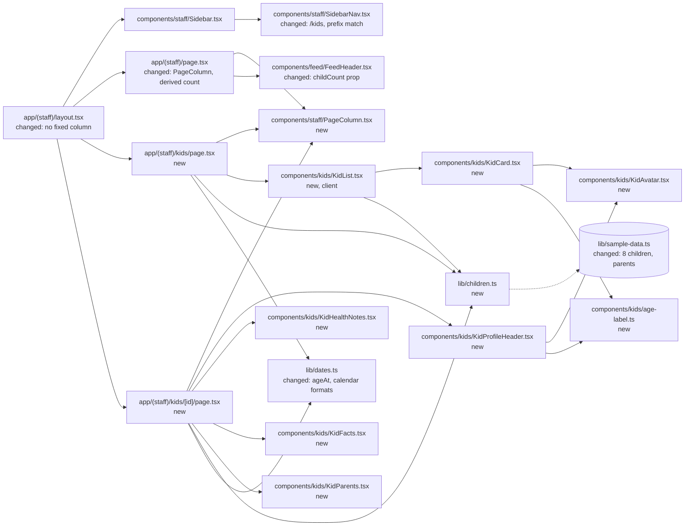
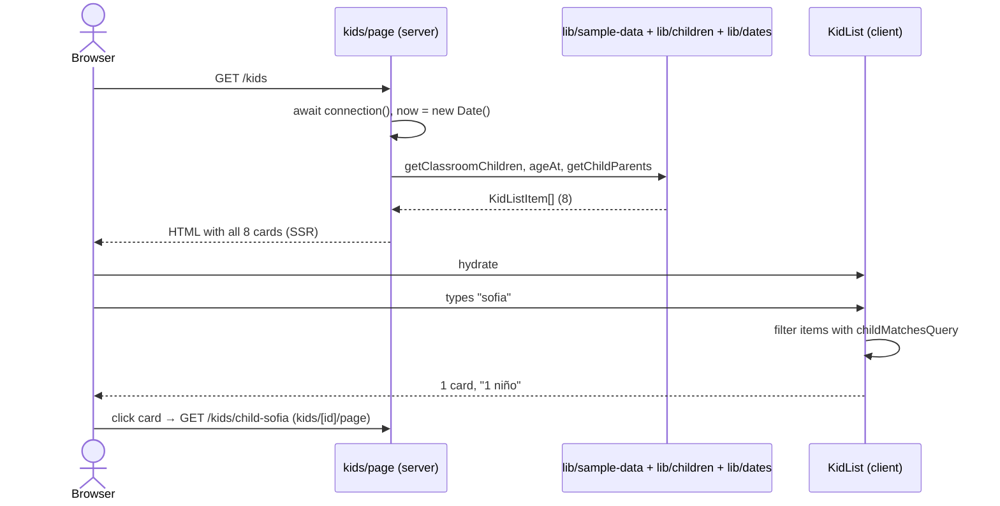

# SPEC 02 — Children list and child profile · Design

> **Spec:** [requirements](./requirements.md) · design · [tasks](./tasks.md)

## Overview

Two new routes join the `(staff)` route group: `kids/page.tsx` (the list) and `kids/[id]/page.tsx` (the profile). Both are Server Components that call `connection()`, because ages depend on today's date. The only client component is `KidList`, which owns the search text and filters the cards on every keystroke. The server computes ages and parent counts and passes them in as plain serializable props. Sample data grows to the prototype's 8 children and their parents. The classroom's children count is now derived from that list, so the feed reads it too. The shell's fixed 760px column moves out of the layout into a `PageColumn` component, because each prototype uses its own width (760 / 880 / 820).

**Naming.** The domain type stays `Child` (glossary). URLs, route keys and components use `kid` (`/kids`, `routes.kidDetail`, `KidCard`), as the user asked for `/kids`. This also avoids clashing with React's `children` prop, which SPEC 01 already worked around with the `kids` prop.

## Architecture



## Components and interfaces

### `app/(staff)/layout.tsx` (changed)

`main` keeps `h-screen min-w-0 flex-1 overflow-y-auto`. The inner `max-w-[760px] px-10 pt-[34px] pb-20` wrapper is removed: each page now renders its own `PageColumn`.

### `components/staff/PageColumn.tsx` (new)

The centered content column inside `main`.

- `PageColumn({ maxWidth, children }: { maxWidth: 760 | 820 | 880; children: ReactNode })`.
- Renders `<div className={`mx-auto w-full px-10 pt-[34px] pb-20 ${COLUMN_WIDTHS[maxWidth]}`}>`, where `COLUMN_WIDTHS` maps each width to a static class (`"max-w-[760px]"`, …), so Tailwind sees the full class names. Max-width includes the padding, as in the prototypes (`box-sizing: border-box`).

### `components/staff/SidebarNav.tsx` (changed)

- "Niños" points to `routes.kids`.
- `isActive = href === routes.home ? pathname === href : pathname === href || pathname.startsWith(`${href}/`)`. Feed stays exact-match (1.3), and Niños is active on `/kids/<…>` (1.2).

### `app/(staff)/page.tsx` (changed)

- Wraps its content in `<PageColumn maxWidth={760}>`.
- `const kids = getClassroomChildren(children, classroom.id)`. It passes `childCount={kids.length}` to `FeedHeader` and `kids` to `PostQuickCreate` (6.3, 6.4).

### `components/feed/FeedHeader.tsx` (changed)

- Props become `{ classroom: Classroom; user: StaffMember; now: Date; childCount: number }`. It reads `childCount` instead of `classroom.childrenCount`.

### `components/feed/PostCard.tsx`, `components/feed/PostQuickCreate.tsx` (changed)

- `child.name` becomes `child.firstName` (avatar initial, title, "Para: familia de …", select options). Nothing else changes (6.6).

### `app/(staff)/kids/page.tsx` (new)

The list at `/kids`.

- `export default async function KidsPage()`: `await connection()`, `now = new Date()`, `kids = getClassroomChildren(children, classroom.id)`.
- Builds `items: KidListItem[]` = `kids.map((child) => ({ child, age: ageAt(child.birthDate, now), parentCount: getChildParents(parents, child.id).length }))`.
- Renders `<PageColumn maxWidth={880}>` with the header row (eyebrow "GESTIÓN", `h1` "Niños", the "Agregar niño" `<Link href={routes.kidNew}>` with `PlusIcon`) and then `<KidList classroomName={classroom.name} items={items} />`.

### `components/kids/KidList.tsx` (new, `"use client"`)

Search box, section header and grid. It's the only client component in this spec.

- Props: `{ classroomName: string; items: KidListItem[] }`, with `export type KidListItem = { child: Child; age: Age; parentCount: number }`. Everything is plain JSON (strings and numbers), so it crosses the server/client boundary.
- State: `const [query, setQuery] = useState("")`. `visible = items.filter(({ child }) => childMatchesQuery(child, query))`.
- Search box: `SearchIcon` plus `<input type="search" placeholder="Buscar niño…" aria-label="Buscar niño" value={query} onChange={…}>`. It's not inside a `<form>`, so Enter does nothing (3.1).
- Section header: "SALA {classroomName.toUpperCase()}", "{n} {n === 1 ? "niño" : "niños"}" with `n = visible.length`, and the rule (2.3, 3.5).
- Body, in order:
  1. `items.length === 0` → "Todavía no hay niños en esta sala." (2.12)
  2. `visible.length === 0` → "Ningún niño coincide con «{query.trim()}»." (3.6)
  3. otherwise a `grid grid-cols-2 gap-3.5` of `KidCard`s (2.4).

### `components/kids/KidCard.tsx` (new)

- Props: `KidListItem`. Renders a `<Link href={routes.kidDetail(child.id)}>` card (1.4) with `KidAvatar size={48}`, the full name, and "{formatAgeLabel(age)} · {parentsLabel}".
- `parentsLabel`: `0` → "sin padres vinculados", `1` → "1 padre vinculado", `n` → "{n} padres vinculados" (2.6).
- Right slot (2.7–2.10): `child.allergy !== null` → chip `child.allergy` with `uppercase` (`bg-[#FBD8CC] text-[#D9684A]`); else `parentCount === 0` → "VINCULAR" chip (`bg-[#F9D2DE] text-[#C56486]`); else `ChevronRightIcon` in `#CBB89F`.
- Hover (2.11): `transition duration-150 hover:-translate-y-0.5 hover:border-[#F2A78E]`.
- It's imported by `KidList`, so it renders on the client, but it has no state or handlers.

### `components/kids/KidAvatar.tsx` (new)

- `KidAvatar({ child, size }: { child: Child; size: 48 | 84 })`. Renders the first-name initial in a circle with inline `style={{ backgroundColor: child.avatarBg, color: child.avatarFg }}`. `AVATAR_SIZES` maps `48` → `size-12 text-[19px]` and `84` → `size-[84px] text-[34px]`.

### `components/kids/age-label.ts` (new)

- `formatAgeLabel({ years, months }: Age): string` → `years >= 1` ? "1 año" / "{years} años" : "1 mes" / "{months} meses" (5.2, 5.3). It lives in `components/` because it's UI copy, and it's shared by `KidCard` and `KidProfileHeader`.

### `app/(staff)/kids/[id]/page.tsx` (new)

The profile at `/kids/<id>`.

- `export default async function KidPage({ params }: PageProps<"/kids/[id]">)`: `const { id } = await params`, `await connection()`, `now = new Date()`.
- `child = getChild(children, id)`. If it's `undefined`, it calls `notFound()` (1.7). Also `childClassroom` = `classroom` (the only one, matched by `child.classroomId`), and `childParents = getChildParents(parents, child.id)`.
- Renders `<PageColumn maxWidth={820}>`:
  - The back link `<Link href={routes.kids}>` with `ChevronLeftIcon` and "Volver a Niños" (1.5, 4.1).
  - `flex flex-wrap items-start gap-[26px]`:
    - Left (`min-w-[300px] flex-1 flex flex-col gap-[18px]`): `KidProfileHeader`, then `KidHealthNotes` when `child.notes !== null` (4.3, 4.4), then `KidFacts`.
    - Right (`w-[300px] flex-none flex flex-col gap-3.5`): the "Resumen del día" `<Link href={routes.kidSummary(child.id)}>` (`bg-ink`, `SunIcon`) (4.6), then `KidParents`.

### `components/kids/KidProfileHeader.tsx` (new)

- Props: `{ child: Child; age: Age; classroomName: string }`. Renders `KidAvatar size={84}`, the `h1` full name, "{formatAgeLabel(age)} · Sala {classroomName}", and the "Editar" `<Link href={routes.kidEdit(child.id)}>` (4.2).

### `components/kids/KidHealthNotes.tsx` (new)

- Props: `{ notes: string }`. The `#FBDAD6` box with the `AlertTriangleIcon` tile (`#F4A8A0`), "Alergias y notas" (`#C5413A`) and the text (`#B25249`) (4.3).

### `components/kids/KidFacts.tsx` (new)

- Props: `{ child: Child; classroomName: string }`. Three rows: "Fecha de nacimiento" → `formatCalendarDate(child.birthDate)`, "Sala" → `classroomName`, "Ingreso" → `formatCalendarMonth(child.enrolledOn)` (4.5).

### `components/kids/KidParents.tsx` (new)

- Props: `{ childId: string; parents: Parent[] }`.
- Local maps: `RELATIONSHIP_LABELS: Record<ParentRelationship, string>` = `{ mother: "Mamá", father: "Papá", guardian: "Tutor/a" }` (4.8). `PARENT_STATUS: Record<ParentStatus, { text: string; chip: string; className: string }>` = `active` → "cuenta activa" / "ACTIVA" / `bg-[#CFEBD8] text-[#3E9B6C]`, `pending` → "invitación enviada" / "PENDIENTE" / `bg-[#F7E7A6] text-[#9A7B1E]` (4.9, 4.10).
- One row per parent: initial avatar (inline `style` with `parent.avatarBg`, white text), full name, "{relationship} · {status text}", and the chip (4.7).
- Last row: `<Link href={routes.kidLinkParent(childId)}>` with the dashed circle (`#D8CBBA` border, `PlusIcon` in `text-photo-fg`) and "Vincular otro padre", or "Vincular padre" when `parents.length === 0`. The label uses `text-edit` (`#C5503A`) (4.11, 4.12). With no parents, the row drops its `pt-2` top spacing.

### `components/icons.tsx` (changed)

Adds `SearchIcon`, `ChevronRightIcon`, `ChevronLeftIcon` and `AlertTriangleIcon`, copied from `ninos.dc.html` / `perfil-nino.dc.html` with `stroke="currentColor"`.

### `lib/routes.ts` (changed)

```ts
kids: "/kids",                       // replaces children: "/children"
kidNew: "/kids/new",
kidDetail: (id: string) => `/kids/${id}`,
kidEdit: (id: string) => `/kids/${id}/edit`,
kidSummary: (id: string) => `/kids/${id}/summary`,
kidLinkParent: (id: string) => `/kids/${id}/link-parent`,
```

`/kids/new` is caught by `kids/[id]` and gets a 404 from `notFound()`, because no child has the id `new`. `/kids/<id>/edit`, `/summary` and `/link-parent` have no route, so they 404 too (1.6).

### `lib/dates.ts` (changed)

Calendar dates (birth date, enrollment) are `"YYYY-MM-DD"` strings with no time or zone. They're formatted at noon UTC with `timeZone: "UTC"`, so the day never shifts.

- `formatCalendarDate(ymd: string): string` → "12 mar 2023". Uses `Intl.DateTimeFormat(LOCALE, { day: "numeric", month: "short", year: "numeric", timeZone: "UTC" })` and `formatToParts`, keeping day/month/year, lowercased, with trailing `.` removed (same approach as `formatHeaderDate`).
- `formatCalendarMonth(ymd: string): string` → "feb 2026". Same, with month and year only.
- `ageAt(birthDate: string, now: Date): Age`: compares `birthDate` with `dayKey(now)` (app timezone) field by field. `months = (y2 - y1) * 12 + (m2 - m1) - (d2 < d1 ? 1 : 0)`, then `{ years: Math.floor(months / 12), months }`. A birthday on today's date counts (5.1, 5.4). A Feb 29 birth date counts the birthday on Mar 1 in non-leap years.

### `lib/children.ts` (new)

Pure selectors over plain data, like `lib/feed.ts`. They take their data as arguments and don't import `sample-data.ts`, so the client `KidList` can import them.

- `getClassroomChildren(children: Child[], classroomId: string): Child[]` keeps the input order (2.4).
- `getChild(children: Child[], id: string): Child | undefined`.
- `getChildParents(parents: Parent[], childId: string): Parent[]` keeps the input order.
- `fullName(person: { firstName: string; lastName: string }): string` → "Mateo Fernández".
- `normalizeSearch(text: string): string` → `text.normalize("NFD").replace(/\p{Diacritic}/gu, "").toLowerCase().trim()`.
- `childMatchesQuery(child: Child, query: string): boolean` → an empty normalized query matches everything (3.4); otherwise `normalizeSearch(fullName(child)).includes(normalizeSearch(query))` (3.1–3.3).

### `lib/sample-data.ts` (changed)

Exports `currentUser`, `staff`, `classroom` (no `childrenCount`), `children` (8, in this order) and `parents`. `getSamplePosts` is unchanged.

| id | Name | Colors (bg / fg) | Birth date | Enrolled | Allergy | Notes |
| --- | --- | --- | --- | --- | --- | --- |
| `child-mateo` | Mateo Fernández | `#A9D9E8` / `#1F7A93` | 2023-03-12 | 2026-02-02 | Maní | "Alergia al maní. Evitar frutos secos. Lleva inhalador en la mochila." |
| `child-sofia` | Sofía Méndez | `#F4B8CC` / `#C44A7A` | 2024-05-20 | 2026-03-02 | — | — |
| `child-benjamin` | Benjamín Ruiz | `#B9DEC4` / `#3E8B62` | 2023-01-08 | 2025-03-03 | — | — |
| `child-valentina` | Valentina Soto | `#F4DC8E` / `#9A7B1E` | 2024-02-14 | 2026-03-02 | — | — |
| `child-tomas` | Tomás Díaz | `#C9B6E8` / `#7B5FC0` | 2023-06-30 | 2025-03-03 | Lactosa | "Intolerancia a la lactosa. Usar leche sin lactosa en la merienda." |
| `child-emma` | Emma Castro | `#F4B8CC` / `#C44A7A` | 2024-07-03 | 2026-04-06 | — | — |
| `child-lucas` | Lucas Romero | `#A9D9E8` / `#1F7A93` | 2023-04-22 | 2025-03-03 | — | — |
| `child-olivia` | Olivia Vega | `#B9DEC4` / `#3E8B62` | 2024-01-11 | 2026-03-02 | — | — |

On 2026-10-04 the ages are 3, 2, 3, 2, 3, 2, 3, 2 years, as in the prototype. Every birthday falls between January and July, so they stay the same until 2027-01-08.

| id | Name | Relationship | Status | Avatar bg | Children |
| --- | --- | --- | --- | --- | --- |
| `parent-lucia-fernandez` | Lucía Fernández | mother | active | `#C9B6E8` | Mateo |
| `parent-diego-fernandez` | Diego Fernández | father | pending | `#A9C7E8` | Mateo |
| `parent-carla-mendez` | Carla Méndez | mother | active | `#F4B8CC` | Sofía |
| `parent-paula-ruiz` | Paula Ruiz | mother | active | `#B9DEC4` | Benjamín |
| `parent-martin-ruiz` | Martín Ruiz | father | active | `#A9C7E8` | Benjamín |
| `parent-andrea-diaz` | Andrea Díaz | guardian | active | `#C9B6E8` | Tomás |
| `parent-jorge-castro` | Jorge Castro | father | pending | `#A9C7E8` | Emma |
| `parent-natalia-romero` | Natalia Romero | mother | active | `#F4DC8E` | Lucas |
| `parent-sergio-vega` | Sergio Vega | father | active | `#A9C7E8` | Olivia |

Valentina has no parents. That gives the "VINCULAR" chip, "sin padres vinculados", and the "Vincular padre" profile. She has no notes either, so her profile has no alert box. Tomás covers "Tutor/a".

## Data model

```ts
// lib/types.ts (changes only)
export type Classroom = {
  id: string;
  name: string;            // "Soles" (childrenCount removed: derived from children)
};

export type Child = {
  id: string;              // "child-mateo"
  firstName: string;       // "Mateo" (replaces name)
  lastName: string;        // "Fernández"
  classroomId: string;     // "classroom-soles"
  avatarBg: string;        // "#A9D9E8"
  avatarFg: string;        // "#1F7A93"
  birthDate: string;       // "2023-03-12", calendar date, no zone
  enrolledOn: string;      // "2026-02-02", calendar date, no zone
  /** Short allergy name for the list chip, e.g. "Maní". `null` → no allergy. */
  allergy: string | null;
  /** Free text for "Alergias y notas". `null` → the box is hidden. */
  notes: string | null;
};

export type ParentRelationship = "mother" | "father" | "guardian";
export type ParentStatus = "active" | "pending";

export type Parent = {
  id: string;
  firstName: string;
  lastName: string;
  relationship: ParentRelationship;
  status: ParentStatus;
  avatarBg: string;        // initial is white
  childIds: string[];      // a parent can be linked to several children
};

export type Age = { years: number; months: number };  // months = total completed months
```

Sample data rule: a child with an `allergy` also has `notes`, so the chip and the alert box agree. The `allergy` and `notes` values are user content (Spanish), like post bodies, so they're allowed in `lib/sample-data.ts`. Nothing is persisted.

## Data flow



## Error handling

| Failure / edge case | Where it is detected | Behavior | Req. |
| --- | --- | --- | --- |
| Unknown child id (including `new`) | `kids/[id]/page` (`getChild` → `undefined`) | `notFound()` → standard 404 | 1.6, 1.7 |
| Link to an unbuilt screen | Next router | Default 404 | 1.6 |
| No children in the classroom | `KidList` (`items.length === 0`) | "0 niños" + "Todavía no hay niños en esta sala." | 2.12 |
| Search with no matches | `KidList` (`visible.length === 0`) | "0 niños" + "Ningún niño coincide con «…»." | 3.6 |
| Search text with spaces, case or accents | `normalizeSearch` | Trimmed, lowercased, diacritics removed on both sides | 3.2–3.4 |
| Allergy and no parents | `KidCard` | Allergy chip only | 2.9 |
| No notes | `kids/[id]/page` | `KidHealthNotes` not rendered | 4.4 |
| No parents | `KidParents` | Only "Vincular padre" | 4.12 |
| Child under 1 year | `formatAgeLabel` | "N meses" / "1 mes" | 5.3 |
| Birthday today, or born Feb 29 | `ageAt` | Today counts. Feb 29 rolls over on Mar 1 | 5.4 |
| Server/browser in another timezone | `ageAt` uses `dayKey(now)`. Calendar dates are formatted in UTC | Same output everywhere | 4.5, 5.1 |
| Client clock differs from server | Ages are computed on the server only. `KidList` never reads the clock | No hydration mismatch | 5.1 |
| Classroom/parent lookup misses (bad sample data) | Pages | The sample data is static, so a miss fails on the first `npm run dev` | — |

## Testing strategy

There is no test runner (see `tech.md`), so verification is:

- `npm run lint`, `npx tsc --noEmit` and `npm run build` pass. The build lists `/`, `/kids` and `/kids/[id]` as dynamic (`ƒ`).
- Logic check with a one-off `node -e` that copies the `ageAt`, `formatAgeLabel`, `normalizeSearch` and calendar-format logic:
  - `ageAt("2023-10-04", 2026-10-04 in Madrid)` → 3 years; same birth date on 2026-10-03 → 2 years.
  - `ageAt("2026-05-10", 2026-10-04)` → "4 meses", and a birth date of today → "0 meses".
  - `ageAt("2024-02-29", 2025-02-28)` → 0 years, and on 2025-03-01 → 1 year.
  - `normalizeSearch("  SOFÍA ")` → `"sofia"`.
  - `formatCalendarDate("2023-03-12")` → "12 mar 2023", `formatCalendarMonth("2026-02-02")` → "feb 2026", `formatCalendarMonth("2025-09-01")` → "sept 2025".
- Visual check with Playwright MCP at 1280×800, with artifacts in `.playwright-mcp/`. Serve the prototypes with `python3 -m http.server 4173` from `references/templates/`. Compare `/kids` with `ninos.dc.html` and `/kids/child-mateo` with `perfil-nino.dc.html`, and check that `/` still matches `feed.dc.html` apart from "8 niños" (6.5, 6.6). Resize after navigating.
- Behavior checks in the browser: the search cases from requirement 3; the hover lift on a card; card → profile → "Volver a Niños"; "Niños" active on `/kids` and `/kids/child-mateo`, and "Feed" active only on `/`; the 404s for `/kids/nope`, `/kids/new`, `/kids/child-mateo/edit`, `/kids/child-mateo/summary` and `/kids/child-mateo/link-parent`; Valentina's profile (no box, "Vincular padre"); Tomás's profile ("Tutor/a · cuenta activa"); the feed "Para" selector with 8 names.
- Temporary edits, reverted afterwards: give Valentina an allergy to see only the allergy chip (2.9); make the classroom empty to see "0 niños" and the empty message (2.12).
- Copy check: `grep -rnE "\b(vos|Compartí|Buenas|Agregá|Buscá)\b" app components` finds nothing (6.7). Accented Spanish in `lib/` appears only in `sample-data.ts`.

## Decisions

- **Yes:** `/kids` and `/kids/<id>` URLs, with `kid` naming in routes and components. The domain type stays `Child`. (User decision.)
- **Yes:** live, client-side search by full name, ignoring case and accents. It's one small client component, and the server still renders the full list. **No:** search via `?q=` with a server round-trip. It's slower per keystroke and the data is tiny. (User decision for live filtering.)
- **Yes:** the classroom's children count is derived from the children list. **No:** keeping `childrenCount: 12` beside an 8-child list. The feed header changes to "8 niños". (User decision.)
- **Yes:** chip priority allergy > "VINCULAR" > chevron. Allergy is safety information. (User decision.)
- **Yes:** links to the final future URLs, which 404 for now, as in SPEC 01. (User decision.)
- **Yes:** hide "Alergias y notas" when there are no notes. (User decision.)
- **Yes:** age computed from the birth date in the app timezone, in months under 1 year. (User decision.) **Yes:** sample dates moved one year forward from the prototype so the ages still match it.
- **Yes:** relationships `mother` / `father` / `guardian` → "Mamá" / "Papá" / "Tutor/a". (User decision.)
- **Yes:** status copy "cuenta activa" / "invitación enviada" with chips "ACTIVA" / "PENDIENTE" for every relationship. **No:** gendered "activo/activa". (User decision.)
- **Yes:** unknown ids → `notFound()`. **No:** redirecting to `/kids`. (User decision.)
- **Yes:** list order = sample-data order, which matches the prototype. **No:** alphabetical. (User decision.)
- **Yes:** pending parents count as "vinculados" in the list subtitle. The prototype shows Mateo with "2 padres vinculados", one of them pending.
- **Yes:** `PageColumn` with a per-page max-width (760 / 880 / 820, as in each prototype). **No:** one shared 760px column in the layout, which would break the list's 2-column grid and the profile's two columns.
- **Yes:** "Niños" is active by path prefix. "Feed" stays exact-match, or it would be active everywhere.
- **Yes:** calendar dates stored as `"YYYY-MM-DD"` strings and formatted in UTC. **No:** `Date` objects for birth dates, which shift a day across timezones.
- **Yes:** `Child.name` split into `firstName` / `lastName`. The feed keeps showing first names only.
- **Yes:** `Parent.childIds` (a parent can have several children). **No:** `Child.parentIds`, which would duplicate the link.
- **Yes:** `lib/children.ts` with pure selectors that take data as arguments, so the client component can import them without bundling the sample data.
- **No:** per-page `<title>` metadata. It's not in the prototypes or the requirements.

## Risks

| Risk | Mitigation |
| --- | --- |
| Sample ages drift from the prototype after 2027-01-08 (the first birthday) | Ages are meant to be live. The fidelity check (6.1, 6.5) is dated 2026-10-04. Shift the sample dates if it's re-run later. |
| `Intl` short months vary by ICU ("sept", "mar.") | `formatToParts`, then strip trailing periods. The `node -e` check covers September. |
| `\p{Diacritic}` strips more than accents (e.g. `ñ` → `n`) | That's acceptable for search: "nino" matches "niño". Display text is never normalized. |
| `PageColumn` refactor changes the feed's spacing | The column classes are identical for 760. The feed screenshot is re-compared (6.6). |

## Steering impact

- `architecture.md`: the `(staff)` shell no longer owns the content column. Pages render `PageColumn` with their prototype's width. Add the children screens' data flow (`/kids` → `KidList` client filter; `/kids/[id]` → `notFound()` for unknown ids). Note that client components get plain serializable props computed on the server (ages), and that `lib/` selectors used by client components must not import `sample-data.ts`. Add decisions: "Children count derived from the children list (SPEC 02)", "Calendar dates are `YYYY-MM-DD` strings formatted in UTC (SPEC 02)".
- `structure.md`: add `app/(staff)/kids/` (`page.tsx`, `[id]/page.tsx`), `components/kids/` (`KidList`, `KidCard`, `KidAvatar`, `KidProfileHeader`, `KidHealthNotes`, `KidFacts`, `KidParents`, `age-label.ts`), `components/staff/PageColumn.tsx` and `lib/children.ts`. Add the naming rule: the domain type is `Child`, while URLs, route keys and components use `kid` (`/kids`, `kidDetail`, `KidCard`). Route keys: `kids`, `kidNew`, `kidDetail`, `kidEdit`, `kidSummary`, `kidLinkParent`. `children` → `kids` in `routes`.
- `tech.md`: no change.
- `product.md`: add the main feature "Children list (`/kids`, live search by name) and child profile (`/kids/<id>`) (SPEC 02)". Update the feed bullet: the children count is derived (8 in the sample data). Add the glossary term "Parent relationship: `mother` / `father` / `guardian` → Mamá / Papá / Tutor/a" and "Parent status: `active` / `pending` → cuenta activa / invitación enviada". Add the product constraint: allergy information takes priority over other list badges.
