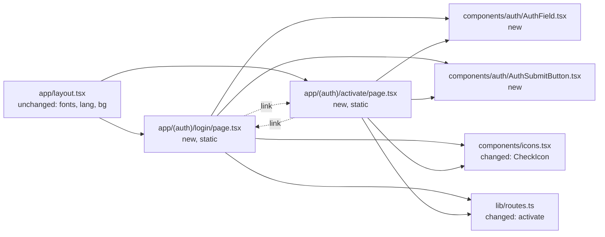

# SPEC 03 — Login and account activation · Design

> **Spec:** [requirements](./requirements.md) · design · [tasks](./tasks.md)

## Overview

Two static Server Component pages join a new `(auth)` route group: `login/page.tsx` and `activate/page.tsx`. The group has no `layout.tsx` and no shell: each page renders its own full-viewport container, because the login screen is a two-panel grid and the activation screen a centered column. Neither page depends on the current time, so unlike the feed and the children screens they do **not** call `connection()` and render statically. The screens are display-only: there is no backend, so every field is an uncontrolled native input and the two submit buttons are inert `type="button"` elements. The only shared chrome between the two files is the label-plus-field pair and the coral button, which move to `components/auth/`. No new data structures are introduced; the invitation card and the prefilled sample values are static markup.

**Language rule.** All code is in English: identifiers, types, file and route names, and comments. Spanish (es-419) UI strings live only in the rendered templates under `app/` and `components/`. The sample values (e-mail addresses, names, the code `7K4P9`) are user content, like post bodies, so they may appear in the pages.

## Architecture



## Components and interfaces

### `app/(auth)/login/page.tsx` (new)

The login screen at `/login`. A static Server Component (no `connection()`).

- Renders a `min-h-screen bg-[#FBF4EC]` wrapper with `grid grid-cols-2` at desktop widths (the prototype uses `grid-template-columns: 1.05fr 1fr`).
- Left brand panel: the coral gradient (155deg `#F6A98E` → `#F2937A` 45% → `#EC7E62`), two translucent decorative circles, the sun tile (`rgba(255,255,255,.22)` background, white `SunIcon`) with "OpenDayCare", the `h1` "El día de cada niño, compartido con su familia.", the paragraph, and the footer "🌿 Guardería Sala Soles".
- Right form column: `h2` "Iniciar sesión", the subtitle, `<AuthField id="email" label="EMAIL" type="email" defaultValue="caro@opendaycare.com" />`, `<AuthField id="password" label="CONTRASEÑA" type="password" placeholder="••••••••" />`, the right-aligned inert "¿Olvidaste tu contraseña?" (`<span>` in `text-edit`), `<AuthSubmitButton>Iniciar sesión</AuthSubmitButton>`, and the footer "¿Te invitó la guardería? " with `<Link href={routes.activate}>` "Activa tu cuenta".
- The prototype's "INGRESO COMO" block is not rendered (1.5).

### `app/(auth)/activate/page.tsx` (new)

The activation screen at `/activate`. A static Server Component.

- Renders a `min-h-screen bg-[#FBF4EC] flex items-center justify-center` wrapper with a `max-w-[440px]` column.
- Top to bottom: the sun tile (58px, gradient `#F8C3A8` → `#F2937A`, shadow), the `h1` "Te damos la bienvenida a OpenDayCare", the paragraph, the invitation card, `<AuthField id="code" label="CÓDIGO DE INVITACIÓN" variant="code" defaultValue="7K4P9" />`, `<AuthField id="email" label="EMAIL" type="email" defaultValue="lucia.fernandez@gmail.com" />`, `<AuthField id="password" label="CREAR CONTRASEÑA" type="password" defaultValue="contraseña" />`, the consent checkbox, `<AuthSubmitButton>Activar mi cuenta</AuthSubmitButton>`, and the footer "¿Ya tienes cuenta? " with `<Link href={routes.login}>` "Iniciar sesión".
- Invitation card (2.3): a surface box with the initials circle "M" (`#A9D9E8` background, `#1F7A93` text) and the two lines "Te invitaron a seguir a" / "Mateo · Sala Soles".
- Consent checkbox (2.5, 2.8): a `<label>` styled as the `#FBF1D6` box, containing a visually hidden `<input type="checkbox" defaultChecked>` and a sibling `<span>` with the `#5FB97E` tile and the white `CheckIcon`. The input uses Tailwind's `peer`; the span is hidden by default and shown with `peer-checked:` classes, so it toggles with no client JavaScript. The text is "Autorizo a la guardería a tomar y compartir fotos de mi hijo dentro de la app." in `#8A7234`.

### `components/auth/AuthField.tsx` (new)

The label-over-field pair shared by both screens.

- `AuthField({ id, label, type = "text", defaultValue, placeholder, variant = "default" }: { id: string; label: string; type?: "text" | "email" | "password"; defaultValue?: string; placeholder?: string; variant?: "default" | "code" })`.
- Renders a `<label htmlFor={id}>` with the uppercase label and an `<input id={id} type={type} defaultValue={defaultValue} placeholder={placeholder}>`, both uncontrolled and outside any `<form>`.
- `variant="code"` switches the input to the prototype's code style (`font-display`, 18px, `tracking-[3px]`, weight 700); `variant="default"` uses 15px Nunito. Both use a white background, the `1.5px #EADFD0` border and the 14px radius.

### `components/auth/AuthSubmitButton.tsx` (new)

The coral gradient access button, shared by both screens.

- `AuthSubmitButton({ children }: { children: ReactNode })`.
- Renders `<button type="button" className="w-full rounded-[15px] bg-gradient-to-b from-[#F4977E] to-[#EE8164] py-[15px] text-center text-[16px] font-extrabold text-white shadow-[0_10px_22px_-8px_rgba(238,129,100,.7)]">`. `type="button"` and no handler make it inert (1.8, 2.9).

### `components/icons.tsx` (changed)

- Add `CheckIcon`, the check polyline (`<polyline points="20 6 9 17 4 12"/>`) copied from the consent checkbox in `activar-cuenta.dc.html`. `SunIcon` already exists (SPEC 01).

### `lib/routes.ts` (changed)

```ts
activate: "/activate",   // new
```

`login: "/login"` already exists. `/activate` was a 404; this spec adds the route.

## Data model

This feature introduces no new data structures. It reuses the model from SPEC 01 and hardcodes the sample values (the login e-mail, the invitation code and e-mail, the child name and colors) inline in the two pages, which have no domain selectors.

## Data flow

1. `GET /login` → the root layout supplies the fonts, `<html lang="es-419">` and the base `body`; `login/page` renders the brand panel and the form column as static HTML. The browser owns the uncontrolled fields; typing changes the input values with no server round-trip.
2. The "Activa tu cuenta" link navigates to `/activate`; `activate/page` renders the centered column as static HTML. The native checkbox toggles via the `peer` styling.
3. The "Iniciar sesión" link on the activation screen returns to `/login`.
4. The staff sidebar's "Cerrar sesión" link (SPEC 01) navigates to `/login`, which now resolves instead of 404ing.

## Error handling

| Failure / edge case | Where it is detected | Behavior | Req. |
| --- | --- | --- | --- |
| Enter pressed in a field | Both pages: fields are outside any `<form>` | Nothing happens; no submit, no navigation, no reload | 1.7, 2.7 |
| "Iniciar sesión" / "Activar mi cuenta" clicked | `AuthSubmitButton` (`type="button"`, no handler) | No navigation, reload or field reset | 1.8, 2.9 |
| "¿Olvidaste tu contraseña?" clicked | `login/page` (plain `<span>`) | No navigation and no dialog | 1.9 |
| Consent checkbox clicked | Native input, toggled through `peer` | Checked state toggles; no navigation or reload | 2.8 |
| Sidebar "Cerrar sesión" clicked | Staff `Sidebar` link (SPEC 01) | Navigates to `/login`, which now renders instead of the 404 | 1.11 |
| Unbuilt destination | — | This spec adds no new unbuilt links: `/login` and `/activate` both exist | — |
| Server/browser in another timezone | Both pages | Neither page reads the clock, so the output is static and identical for everyone | 3.3 |

## Testing strategy

There is no test runner (see `tech.md`), so verification is:

- `npm run lint`, `npx tsc --noEmit` and `npm run build` pass. The build lists `/login` and `/activate` as static (`○`), not dynamic.
- Visual check with Playwright MCP at 1280×800, with artifacts in `.playwright-mcp/`. Serve the prototypes with `python3 -m http.server 4173` from `references/templates/`. Compare `/login` with `login.dc.html` and `/activate` with `activar-cuenta.dc.html`. Resize after navigating. Expected differences are only the strings in the requirements' **UI copy adaptation** table and the omitted role picker.
- Behavior checks in the browser: typing in each field keeps the text; pressing Enter does nothing; clicking "Iniciar sesión" and "Activar mi cuenta" does nothing (no navigation, no reload, fields keep their values); "¿Olvidaste tu contraseña?" does nothing; the consent checkbox starts checked and toggles on click; "Activa tu cuenta" → `/activate`, "Iniciar sesión" (activation) → `/login`, and the staff sidebar's "Cerrar sesión" → `/login`.
- Copy check: `grep -rnE "\b(vos|Ingresá|Activá|Creá|tenés|Publicá|gestioná|mantené|invitó)\b" app components` finds nothing (3.4).

## Decisions

- **Yes:** omit the login prototype's "INGRESO COMO" role picker. The user asked to leave out the staff/family selector. **No:** porting the two role buttons.
- **Yes:** both submit buttons are inert (`type="button"`, no handler). There is no backend, and real login and activation go in their own specs. (User decision.)
- **Yes:** keep the prototypes' prefilled values as uncontrolled `defaultValue` (login e-mail; activation code, e-mail and password), so the 1280×800 visual check matches. (User decision.)
- **Yes:** "¿Olvidaste tu contraseña?" is inert text, faithful to the prototype. Password reset is out of scope. (User decision.)
- **Yes:** "Te damos la bienvenida a OpenDayCare", gender-neutral, replacing the prototype's feminine "Bienvenida". (User decision, consistent with SPEC 02's "cuenta activa".)
- **Yes:** the URL is `/activate` with route key `activate`, an English URL and a plain single-screen key like `login`. (Convention.)
- **Yes:** no `<form>` element on either page. Implicit form submission on Enter would reload or navigate, which the requirements forbid; without a form, Enter is inert and no client JavaScript is needed. **No:** a `<form>` with a client `onSubmit` that calls `preventDefault()`, or `action="#"`.
- **Yes:** the consent checkbox is a visually hidden native input styled with `peer-checked:` classes. It toggles natively and keeps both pages Server Components. **No:** a client component with controlled state.
- **Yes:** both pages render statically, with no `connection()`. Unlike the feed and the children screens, nothing here depends on the current time.
- **Yes:** the invitation card is static markup in the page. There is no invitation domain type, and inventing one is out of scope.
- **Yes:** a new `(auth)` route group with no shared `layout.tsx`; each page owns its full-viewport container. **No:** reusing the staff shell, and **no:** a shared auth layout, since the two screens have different structures.
- **Yes:** `components/auth/` with `AuthField` and `AuthSubmitButton`. The label-plus-field pair appears five times and the coral button twice. **No:** duplicating the markup across the two pages.
- **Yes:** reuse the theme tokens where they match (`text-edit` `#C5503A`, `text-ink`, `text-muted`). **No:** changing shared tokens: the auth prototypes use slightly different one-off values (page background `#FBF4EC`, field border `#EADFD0`, placeholder `#B6A99B`, the gradients), which stay as arbitrary values at their point of use, as SPEC 01 established.
- **No:** per-page `<title>` metadata. It is not in the prototypes or the requirements (SPEC 02 precedent).

## Risks

| Risk | Mitigation |
| --- | --- |
| The auth prototypes use palette values that differ from SPEC 01 tokens (background `#FBF4EC` vs `#F6ECDF`, border `#EADFD0` vs `#ECE0D0`) | Match the prototypes with arbitrary values on the auth screens only; leave the shared tokens untouched. |
| The root `body` has `bg-cream`; the auth pages are `#FBF4EC` | Each page's outer container is `min-h-screen bg-[#FBF4EC]`, covering the body at every viewport height. |
| Native checkbox chrome differs across browsers | The real input is `sr-only`; only the peer-styled `#5FB97E` tile is shown. |
| The disabled "Ingresá" voseo slipped into copy | The copy grep in the testing strategy covers the voseo verbs. |

## Steering impact

- `architecture.md`: add the `(auth)` route group — login and activation, no shell, rendered statically. Clarify that `connection()` is only for pages that depend on "now"; the access screens do not use it.
- `structure.md`: add `app/(auth)/login/page.tsx`, `app/(auth)/activate/page.tsx` and `components/auth/` (`AuthField.tsx`, `AuthSubmitButton.tsx`). Add the route key `activate` to the `routes.*` list.
- `tech.md`: no change.
- `product.md`: update the Access bullet — login (`/login`) and account activation (`/activate`) exist as display-only screens with no authentication and no role picker; add them to the main features.
