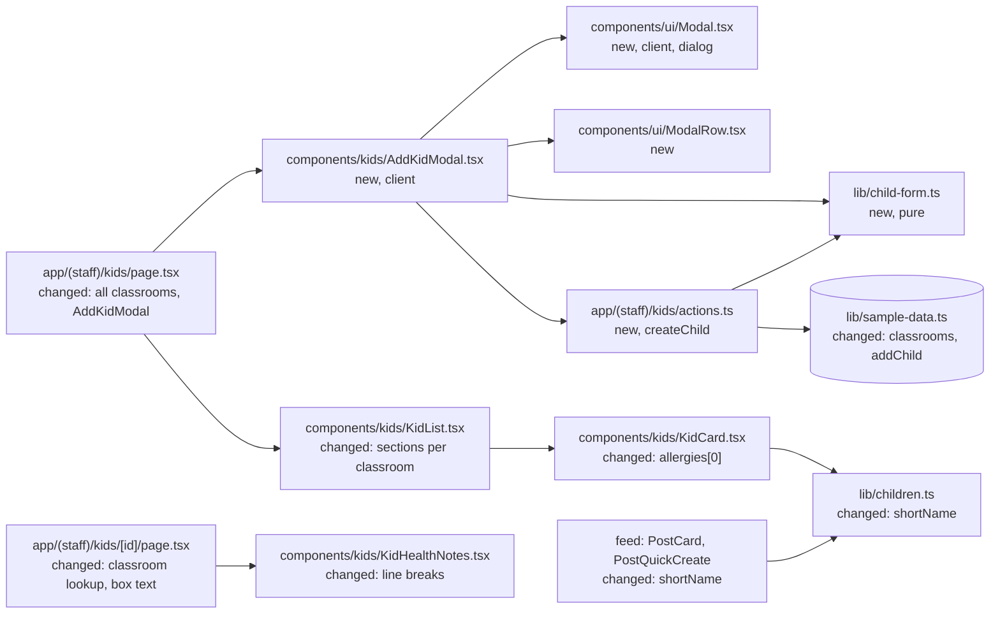
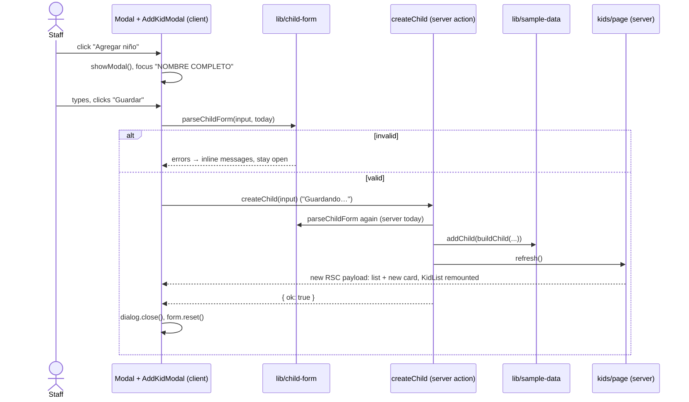

# SPEC 04 — Add child modal · Design

> **Spec:** [requirements](./requirements.md) · design · [tasks](./tasks.md)

## Overview

The "Agregar niño" link on `/kids` becomes the trigger of a generic `Modal` client component, built on a native `<dialog>`. `Modal` owns its open state, the discard confirmation, Escape and outside clicks, and the pending state. It wraps its children (a stack of `ModalRow`s) in a `<form>`. A specific `AddKidModal` composes the fields, validates them with a pure `lib/child-form.ts` module, and calls a `createChild` Server Action. The action validates again, appends the child to the in-memory sample data and calls `refresh()`, so the server-rendered list re-renders without a reload. There is no new route: `/kids/new` keeps hitting `kids/[id]` and its `notFound()`. Alongside this, `Child` switches to a single `fullName` and an `allergies` list, the sample data gains the Lunas and Estrellas classrooms, and `KidList` renders one section per classroom.

## Architecture



## Components and interfaces

### `components/ui/Modal.tsx` (new, `"use client"`)

A generic modal dialog with a header and a form body. This is the first component in `components/ui/`, the home for generic, domain-free UI.

```ts
type ModalProps = {
  title: string;                 // header center, e.g. "Agregar niño"
  trigger: ReactNode;            // content of the opening <button>
  triggerClassName: string;      // classes for that <button>
  /** Returns true to close the modal, false to keep it open (validation or save errors). */
  onSave: (formData: FormData) => Promise<boolean>;
  /** Called after every close, so the caller can clear its own state (errors). */
  onClose?: () => void;
  children: ReactNode;           // ModalRow elements
};
```

- State: `open`, `confirming` (discard confirmation shown) and `saving`, plus refs to the `<dialog>`, the `<form>` and the mouse-down target.
- Trigger: `<button type="button" className={triggerClassName}>` → `setOpen(true)`. An effect calls `dialog.showModal()` when `open` becomes true. That makes the page inert and dims it through `::backdrop` (1.1, 1.2). `showModal()` focuses the first focusable control in the form, which is "NOMBRE COMPLETO" (1.3). Closing with `dialog.close()` returns focus to the trigger (2.9).
- Markup: `<dialog>` is the card itself (`w-[520px] max-w-[calc(100%-48px)] mt-10 p-0 rounded-3xl border border-line bg-[#FBF4EC] shadow-[0_20px_50px_-24px_rgba(63,54,46,.35)] backdrop:bg-[rgba(63,54,46,.35)]`), positioned top-center like the prototype (`align-items: flex-start; padding: 40px 24px`) (7.1). Inside it is one `<form noValidate onSubmit={…}>` holding:
  - The header (`flex items-center justify-between px-[26px] py-5 border-b border-line`): a "Cancelar" `<button type="button">` (`text-[15px] font-bold text-muted`), the title (`font-display text-[18px] font-semibold text-ink`) and a "Guardar" `<button type="submit">` (`text-[15px] font-extrabold text-accent-text`) whose label is "Guardando…" while `saving` (1.4, 4.2). While `confirming`, the header shows only the title.
  - The body (`px-[26px] py-6`) with `children`. It stays mounted while `confirming` but gets `hidden`, so the typed values are kept (2.4).
  - While `confirming`, a confirmation panel in place of the body: "¿Descartar los cambios?" (`font-display text-[18px] font-semibold`), "Lo que escribiste se perderá." (`text-muted`), and two buttons: "Seguir editando" (bordered, like the profile's "Editar") and "Descartar" (the coral gradient of "Agregar niño") (2.2).
- `requestClose()`: ignored while `saving`. If `isFormDirty(form)` → `setConfirming(true)`, otherwise → `close()` (2.1, 2.2).
- `close()`: `dialog.close()`, `form.reset()`, `confirming = false`, `onClose?.()`, `open = false` (2.5, 2.8).
- Escape: the dialog's `cancel` event calls `preventDefault()`. While `confirming` it sets `confirming = false` (2.4); otherwise it calls `requestClose()`. A `close` event that the browser fires anyway (see **Risks**) runs the same cleanup as `close()`.
- Outside click: `onMouseDown` stores `event.target`. `onClick` treats it as an outside click only when both the press and the click target the `<dialog>` element itself. The card's content fills the dialog, so that only happens on the `::backdrop` (2.7). It is ignored while `confirming` (2.6) or `saving`.
- Submit: `event.preventDefault()`, ignored while `saving`. Then `setSaving(true)`, `ok = await onSave(new FormData(form))`, `setSaving(false)`, and if `ok` → `close()` (4.1, 4.2). Enter in a single-line field submits the form natively (3.9).
- `isFormDirty(form)` (module-private): true when some `input`/`textarea` in `form.elements` has `value !== defaultValue`, or some `select` has a selected option with `defaultSelected === false` (2.3).

### `components/ui/ModalRow.tsx` (new)

- `ModalRow({ children }: { children: ReactNode })` → `<div className="mb-[18px] flex gap-3.5 last:mb-0">{children}</div>`. One row of one or more label + control groups, written by the caller. Single-field rows put one `flex-1` group in it.

### `components/kids/AddKidModal.tsx` (new, `"use client"`)

The add-child form, composed of `Modal` + `ModalRow`s.

- Props: `{ classrooms: Classroom[]; defaultClassroomId: string }`.
- State: `errors: ChildFormErrors` (field → error code) and `saveFailed: boolean`.
- Renders `<Modal title="Agregar niño" trigger={<><PlusIcon size={17} />Agregar niño</>} triggerClassName={…the current link's classes…} onSave={save} onClose={reset}>` with four rows (1.5):
  1. `<label>` "NOMBRE COMPLETO" + `<input name="fullName" placeholder="Ej. Martina López" autoComplete="off">`.
  2. "FECHA DE NACIMIENTO" + `<input name="birthDate" placeholder="dd/mm/aaaa" inputMode="numeric">`, and "SALA" + `<select name="classroomId" defaultValue={defaultClassroomId}>` with one `<option>` per classroom (1.6). The select is `appearance-none` with the prototype's chevron icon on the right and `font-bold`, like the prototype's box.
  3. "ALERGIAS (ETIQUETAS)" + `<input name="allergies" placeholder="Ej. Maní, Lactosa">`.
  4. "NOTAS MÉDICAS" + `<textarea name="notes" placeholder="Indicaciones, medicación, contactos…" className="min-h-[90px] resize-y leading-[1.5]">`.
  - If `saveFailed`, a `<p>` "No se pudo guardar. Intenta de nuevo." after the rows (`text-[13px] font-bold text-accent-text mt-4`) (4.11).
- Field styles, copied from the prototype: labels `text-[12px] font-extrabold tracking-[.7px] text-muted mb-2`; controls `w-full rounded-[14px] border-[1.5px] border-[#EADFD0] bg-white px-4 py-[13px] text-[15px] text-ink placeholder:text-[#B6A99B] outline-none`. With an error, the control gets `border-accent-strong` and `aria-invalid`, and a `<p>` with the message follows it (`mt-1.5 text-[12.5px] font-bold text-accent-text`) (3.1, 3.2).
- `ERROR_MESSAGES: Record<ChildFormError, string>`, a local map: `required` (the name or birth-date message, per field), `invalid-date`, `future`, `too-old`, `invalid-classroom` → "Elige una sala." The copy is in **UI copy adaptation** (3.1–3.5).
- `onChange` on the `<form>`'s fields (delegated through each control's `onChange`) removes that field's key from `errors` (3.7).
- `save(formData)`:
  1. `input = readChildForm(formData)`, then `result = parseChildForm(input, dayKey(new Date()), classrooms.map((c) => c.id))`. If `!result.ok` → `setErrors(result.errors)`, return `false` (3.6).
  2. `try { response = await createChild(input) } catch { setSaveFailed(true); return false }` (4.11).
  3. If `!response.ok` → `setErrors(response.errors)`, return `false` (3.10). Otherwise return `true` (4.1).
- `reset()`: clears `errors` and `saveFailed` (2.8).

### `app/(staff)/kids/actions.ts` (new, `"use server"`)

- `createChild(input: ChildFormInput): Promise<{ ok: true } | { ok: false; errors: ChildFormErrors }>`.
- `today = dayKey(new Date())`, then `result = parseChildForm(input, today, classrooms.map((c) => c.id))`. If it fails → return the errors and store nothing (3.10).
- Otherwise `addChild(buildChild(result.value, { id: \`child-${crypto.randomUUID()}\`, today, position: children.length }))`, then `refresh()` from `next/cache` so the current page re-renders with the new child (4.1, 4.10). Returns `{ ok: true }`.

### `lib/child-form.ts` (new)

Pure parsing and validation, shared by the client and the server. It returns error **codes**, not copy, so `lib/` stays free of UI strings.

```ts
export type ChildFormInput = { fullName: string; birthDate: string; classroomId: string; allergies: string; notes: string };
export type ChildFormError = "required" | "invalid-date" | "future" | "too-old" | "invalid-classroom";
export type ChildFormErrors = Partial<Record<"fullName" | "birthDate" | "classroomId", ChildFormError>>;
export type NewChild = { fullName: string; birthDate: string; classroomId: string; allergies: string[]; notes: string | null };

export function readChildForm(formData: FormData): ChildFormInput;   // missing keys → ""
export function parseChildForm(input: ChildFormInput, today: string, classroomIds: string[]):
  { ok: true; value: NewChild } | { ok: false; errors: ChildFormErrors };
export function buildChild(value: NewChild, meta: { id: string; today: string; position: number }): Child;
export const AVATAR_COLORS: { bg: string; fg: string }[];             // the 5 pairs of criterion 4.6
```

- `fullName`: `trim()` and `/\s+/g` → `" "`. If empty → `required` (3.1, 4.3).
- `birthDate`: trimmed. Empty → `required` (3.2). Doesn't match `^(\d{1,2})/(\d{1,2})/(\d{4})$`, or `Date.UTC` round-trip changes the day or month (31/02) → `invalid-date` (3.3). Converted to `YYYY-MM-DD`, then compared as strings: `> today` → `future` (3.4), `< sixYearsBefore(today)` → `too-old` (3.5). `sixYearsBefore("2026-10-11")` is `"2020-10-11"`. On Feb 29 it gives Feb 28, so the boundary day stays valid.
- `classroomId`: not in `classroomIds` → `invalid-classroom`. That only happens with tampered requests.
- `allergies`: `split(",")`, each item trimmed with spaces collapsed, empties dropped, and kept only if its `normalizeSearch` key wasn't seen before (4.4).
- `notes`: `trim()`, `""` → `null` (5.4).
- `buildChild`: `{ id, ...value, avatarBg/avatarFg: AVATAR_COLORS[position % 5], enrolledOn: today }` (4.6, 4.7).

### `lib/sample-data.ts` (changed)

- `classrooms: Classroom[]` = Soles (`classroom-soles`), Lunas (`classroom-lunas`), Estrellas (`classroom-estrellas`). `classroom` stays exported as the current user's classroom (`classrooms[0]`) for the sidebar and the feed (6.1, 6.6).
- Each child gets `fullName` ("Mateo Fernández") instead of `firstName`/`lastName`, and `allergies` (`["Maní"]`, `["Lactosa"]`, or `[]`) instead of `allergy`.
- `addChild(child: Child): void` pushes to `children`. The array lives in the server's module memory: it survives requests and is lost on restart (4.10). This is the only mutation in the app.

### `lib/types.ts` (changed)

See **Data model**.

### `lib/children.ts` (changed)

- `shortName(child: Child): string` → the first word of `fullName` ("Mateo"), used by the feed (4.12, 7.2).
- `childMatchesQuery` searches `child.fullName`. `fullName(person)` stays for `Parent` only.
- `getChildrenByClassroom(children: Child[], classrooms: Classroom[]): { classroom: Classroom; children: Child[] }[]` → one entry per classroom in classroom order, keeping the input order inside each (4.1, 6.2).

### `app/(staff)/kids/page.tsx` (changed)

- Builds `items` from **all** `children`, not only Soles. The order is the sample-data order, so new children come last.
- Replaces the "Agregar niño" `<Link>` with `<AddKidModal classrooms={classrooms} defaultClassroomId={classroom.id} />` in the same header slot (1.1).
- Renders `<KidList key={children.length} classrooms={classrooms} items={items} />`. The key changes after a save, so `KidList` remounts with an empty search (4.8).

### `components/kids/KidList.tsx` (changed)

- Props: `{ classrooms: Classroom[]; items: KidListItem[] }`, with `classrooms[0]` as the current user's classroom.
- `visible` is filtered as before (6.3). `sections = classrooms.map((c) => ({ c, items: visible.filter(i => i.child.classroomId === c.id) })).filter((s) => s.items.length > 0)`.
- Each section renders the SPEC 02 header ("SALA {NAME}", count, rule) and grid. Sections after the first get `mt-[26px]` (6.2).
- If `sections` is empty: the `classrooms[0]` header with "0 niños" and the SPEC 02 empty or no-match message (6.4). With only Soles populated, the markup is the SPEC 02 markup (6.5).

### `components/kids/KidCard.tsx`, `components/kids/KidAvatar.tsx` (changed)

- `KidCard`: the name is `child.fullName`, and the allergy chip shows `child.allergies[0]` when `allergies.length > 0`. Otherwise the SPEC 02 priority still applies: "VINCULAR", then the chevron (4.5).
- `KidAvatar`: the initial is `child.fullName.charAt(0)`.

### `app/(staff)/kids/[id]/page.tsx` and `components/kids/KidHealthNotes.tsx` (changed)

- The page looks up `childClassroom` in `classrooms` (4.9). It computes `healthText = child.notes ?? (child.allergies.length > 0 ? child.allergies.join(", ") : null)` and renders `KidHealthNotes` only when that's non-null (5.1–5.3). The comment about `new` changes: `/kids/new` 404s because no child has that id, and there is no add-child route (1.7).
- `KidHealthNotes` adds `whitespace-pre-line` to the text (5.1).
- `KidProfileHeader` uses `child.fullName`.

### `components/feed/PostCard.tsx`, `components/feed/PostQuickCreate.tsx` (changed)

- `child.firstName` becomes `shortName(child)`. The output is identical for the sample data (4.12, 7.2).

### `components/icons.tsx` (changed)

- Adds `ChevronDownIcon`, copied from the "SALA" box in `agregar-nino.dc.html` (`m6 9 6 6 6-6`, stroke width 2.2), with `stroke="currentColor"`. It's shown in `#B0A290` (`text-photo-fg`).

### `lib/routes.ts` (changed)

- Removes `kidNew`. Nothing links to `/kids/new` any more (1.7).

## Data model

```ts
// lib/types.ts (changes only)
export type Child = {
  id: string;              // "child-mateo"; new children: "child-<uuid>"
  fullName: string;        // "Mateo Fernández" (replaces firstName + lastName)
  classroomId: string;
  avatarBg: string;
  avatarFg: string;
  birthDate: string;       // "YYYY-MM-DD"
  enrolledOn: string;      // "YYYY-MM-DD"
  /** Allergy names, in the order typed. Empty → no allergy. The list chip shows the first one. */
  allergies: string[];     // replaces allergy: string | null
  /** Free text for "Alergias y notas". `null` → the box shows the allergies, or is hidden. */
  notes: string | null;
};
```

`Classroom` doesn't change. `Parent` keeps `firstName`/`lastName`. The sample data gains `classrooms` (three entries). Nothing is persisted to disk.

## Data flow



## Error handling

| Failure / edge case | Where it is detected | Behavior | Req. |
| --- | --- | --- | --- |
| Close with unchanged fields | `Modal.requestClose` (`isFormDirty` false) | Closes, nothing added | 2.1 |
| Close with changed fields | `Modal.requestClose` | Discard confirmation, values kept | 2.2, 2.3 |
| Escape on the confirmation | `cancel` handler | Back to the form | 2.4 |
| Outside click on the confirmation, or while saving | `onClick` guard | Ignored | 2.6, 4.2 |
| Text selection dragged outside the card | `onMouseDown` target check | Not an outside click | 2.7 |
| Empty name or birth date | `parseChildForm` (client) | `required` → inline message + red border | 3.1, 3.2 |
| Bad format or impossible date ("31/02/2025") | `parseChildForm` | `invalid-date` | 3.3 |
| Future date, or more than 6 years ago | `parseChildForm` | `future` / `too-old` | 3.4, 3.5 |
| Tampered request (bad classroom, skipped checks) | `createChild` re-validates | Nothing stored, errors returned and shown | 3.10 |
| Client and server "today" differ (clock or timezone) | Both use `dayKey` in the app timezone. The server result wins | Server errors shown if they differ | 3.4, 3.5, 3.10 |
| Double click on "Guardar" | `saving` flag | Second submit ignored | 4.2 |
| Server action throws or the network fails | `try/catch` in `AddKidModal.save` | "No se pudo guardar. Intenta de nuevo.", modal open | 4.11 |
| Repeated or empty allergy items | `parseChildForm` | Deduped and dropped | 4.4 |
| Notes with only spaces | `parseChildForm` | `null`; the box falls back to the allergies | 5.2, 5.4 |
| Child saved into an empty classroom | `KidList` sections | That classroom's section appears | 6.2 |
| Server restart | — | Added children are lost (accepted) | 4.10 |

## Testing strategy

There is no test runner (see `tech.md`), so verification is:

- `npm run lint`, `npx tsc --noEmit` and `npm run build` pass. `/kids` is still dynamic (`ƒ`), and there is no `/kids/new` route.
- Logic check with a one-off `node -e` (or `npx tsx -e`) on `lib/child-form.ts`, with `today = "2026-10-11"`:
  - Name: `"  Martina   López "` → `"Martina López"`, and `"   "` → `required`.
  - Birth date: `"11/10/2020"` valid; `"10/10/2020"` → `too-old`; `"12/10/2026"` → `future`; `"11/10/2026"` valid; `"31/02/2025"`, `"2025-03-01"` and `"1/1/25"` → `invalid-date`; `"1/3/2024"` → `"2024-03-01"`.
  - Allergies: `"Maní, , lactosa, MANI"` → `["Maní", "lactosa"]`; `""` → `[]`.
  - Notes `"  "` → `null`. `buildChild` at position 8 → `#F4DC8E`/`#9A7B1E`, with `enrolledOn` = today.
- Browser checks (Playwright MCP, artifacts in `.playwright-mcp/`):
  - Open, the focus in the name field, Soles pre-selected, the URL still `/kids`.
  - The three close paths with an untouched form; each again after typing (confirmation → "Seguir editando" keeps the values → "Descartar"); Escape on the confirmation; type and then delete (no confirmation); a text-selection drag outside the card; reopen after each (empty form).
  - The validation cases, with errors clearing as the field is edited, and Enter submitting.
  - A successful save into Soles (card last, "9 niños", yellow avatar, "VINCULAR" chip, search cleared, profile with "Ingreso oct 2026" and "Vincular padre", the feed shows "9 niños" and the first name in "Para"), then a reload (still there).
  - A save into Lunas (a new "SALA LUNAS" section), and a search across both classrooms.
  - A child with allergies and no notes (profile box lists them), and notes with line breaks.
  - `/kids/new` → 404.
- Temporary edit, reverted afterwards: make `createChild` throw to see the save-failed message (4.11).
- Visual check at 1280×800: serve the prototypes with `python3 -m http.server 4173` from `references/templates/`. Compare the open modal with `agregar-nino.dc.html` (7.1), and `/`, `/kids` and `/kids/child-mateo` with their SPEC 02 screenshots or prototypes (7.2).
- Copy check: `grep -rnE "\b(vos|Ingresá|Usá|Elegí|Intentá|escribís)\b" app components` finds nothing (7.3).

## Decisions

- **Yes:** a modal on `/kids` with no URL change, from a generic client `Modal` over a native `<dialog>`. **No:** intercepting + parallel routes for `/kids/new`, and **no:** a plain `/kids/new` page. (User decision.) Back doesn't close the modal, and `/kids/new` stays a 404.
- **Yes:** `Modal` owns its trigger, its open state, the discard confirmation, Escape and outside clicks, and the pending state, and closes when `onSave` resolves `true`. **No:** a controlled `open`/`onClose` API with a separate trigger component. (User decision.)
- **Yes:** `ModalRow` is only the row `<div>`. Callers write their own `<label>` + control + error markup. **No:** a `ModalField` wrapper. (User decision.)
- **Yes:** `components/ui/` for generic, domain-free components. It's a new folder, since `Modal` belongs to no feature.
- **Yes:** in-memory save through a Server Action that appends to `lib/sample-data.ts` and calls `refresh()`. It's lost on restart. **No:** client-only state, and **no:** display-only. (User decision.)
- **Yes:** validation in a pure `lib/child-form.ts`, run on the client for instant errors and again on the server. It returns codes, and the copy lives in `AddKidModal`.
- **Yes:** the name and the birth date are required, with inline errors on "Guardar". The birth date is typed as `d/m/aaaa`, must be a real date, and must be no later than today and no earlier than 6 years ago. **No:** a native date picker, which looks unlike the prototype. (User decision.)
- **Yes:** one `fullName` for every child. The feed derives the first word, so it looks unchanged. **No:** splitting the typed name. (User decision.)
- **Yes:** `allergies: string[]` from a comma-separated field. The card shows the first allergy, and the profile box falls back to the list when there are no notes. **No:** live tag chips, and **no:** keeping a single `allergy`. (User decision.)
- **Yes:** a real "SALA" select with two new empty classrooms, Lunas and Estrellas, and Soles pre-selected. `/kids` is grouped by classroom. **No:** a Soles-only list that hides other classrooms' children. (User decision.)
- **Yes:** an inline discard confirmation for every close path when the form has changes. **No:** `window.confirm`. (User decision.)
- **Yes:** "dirty" means a value differs from the field's default, so type-then-delete is clean.
- **Yes:** new children go last, avatar colors rotate through the 5 prototype pairs by position, and `enrolledOn` is today. (User decision.)
- **Yes:** the search resets after a save by re-keying `KidList` on the children count. **No:** lifting the search state into the page.
- **Yes:** a dimmed backdrop `rgba(63,54,46,.35)`. The prototype shows the card alone on the page background, so the backdrop color is a new value, reusing the card shadow's ink tint.
- **No:** length limits on the name, allergies or notes. The data is sample data in memory.
- **No:** editing a child with the same modal. It's a future spec, which can reuse `Modal`, `ModalRow` and `lib/child-form.ts`.

## Risks

| Risk | Mitigation |
| --- | --- |
| Chrome's close-watcher closes a `<dialog>` anyway on a second Escape without user activation, even when `cancel` is prevented | A `close` listener runs the normal cleanup (reset form, state). The worst case is a discarded form after a double Escape. Checked in the browser. |
| Module-level `children` is reset when `lib/sample-data.ts` is re-evaluated (dev HMR after editing it, or a restart) | Accepted: persistence is out of scope (4.10). Only editing that file resets it. |
| `refresh()` re-renders while the dialog is open, and the modal could remount and lose its state | `AddKidModal` sits in the page header with a stable position and no key, so React keeps it. Only `KidList` is re-keyed. Checked: the modal closes cleanly after the save. |
| Renaming `firstName`/`lastName` and `allergy` touches feed and profile code | `tsc` flags every use. The visual re-check covers `/`, `/kids` and a profile (7.2). |
| The page behind can still scroll with the wheel while the dialog is open (`main` is the scroll container) | Accepted. Interaction is blocked by `showModal()` (1.2). Scrolling isn't a requirement. |

## Steering impact

- `architecture.md`: add the first mutation path. A client modal calls a Server Action (`app/(staff)/kids/actions.ts`), which validates with a pure `lib/` module, mutates the in-memory `lib/sample-data.ts` (`addChild`) and calls `refresh()` from `next/cache`. Add the data flow for adding a child. Note that client components may include `<dialog>`-based modals from `components/ui/`. The data bullet: sample data now holds three classrooms, and `classroom` is the current user's one. Decisions: "In-memory mutations via Server Actions + `refresh()` until persistence lands (SPEC 04)", "Validation in pure `lib/` modules that return error codes, run on the client and again on the server (SPEC 04)", "Modals without routes: a generic `<dialog>` `Modal` that owns its trigger and state (SPEC 04)". Update the `/kids` data flow: all children, grouped by classroom, and the `AddKidModal` trigger. `/kids/new` 404s through `kids/[id]`.
- `structure.md`: add `components/ui/` (generic, domain-free UI: `Modal`, `ModalRow`), `components/kids/AddKidModal.tsx`, `app/(staff)/kids/actions.ts` and `lib/child-form.ts`. Route keys: remove `kidNew`. Convention: Server Actions live in an `actions.ts` next to the route that uses them. Convention: `lib/` validators return error codes, and components map them to copy.
- `tech.md`: no change.
- `product.md`: the "Children list and child profile" feature now includes adding a child from `/kids` through the "Agregar niño" modal (saved in server memory until restart), and grouping by classroom (SPEC 04). Glossary: note that a child's name is a single full name, and that the feed shows its first word. Add "Allergies: a list per child. The list chip shows the first one". The sample daycare has three classrooms (Soles, Lunas, Estrellas). The current user stays in Soles.
